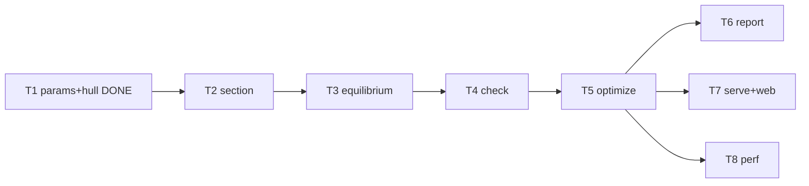

# Rewrite plan

Each task lists the files it owns. Tasks in the same wave touch disjoint files and can run as
parallel agents. Done = `make check` green + the listed acceptance check + committed as `T<n>: ...`.

| Wave | Task | Owns | Acceptance |
|---|---|---|---|
| 0 | **T1** params + hull format + Michlet import | `params.rs` `hull.rs` | DONE (unit tests) |
| 1 | **T2** section properties | `section.rs` | unit tests: rectangle-ish box section vs hand calc; positive A, I everywhere off the tips |
| 1 | **T7a** web viewer, static | `web/index.html` | renders `tests/golden/off1_hull.json` + a hand-written sample result; no build step |
| 2 | **T3** equilibrium | `equilibrium.rs` | `golden_weight_and_draft` un-ignored and passing; Err on a sinking hull (test) |
| 3 | **T4** checks | `check.rs` | `golden_bending_dc` un-ignored and passing; capacity <= 0 gives fail (test) |
| 4 | **T5** optimizer | `optimize.rs` | `jaguar run examples/canoe.toml` finds a verified winner; two runs give identical result.json (test) |
| 5 | **T6** report | `report.rs` | summary <= 40 lines, shows winner, VERIFIED flag, grid-edge warning |
| 5 | **T7b** serve | `serve.rs` | `jaguar serve` serves `/`, `/result.json`, `/hull.json`; refresh picks up a new run |
| 5 | **T8** performance | `section.rs` `equilibrium.rs` (perf only) | default example < 1 s release; golden still passes; add `benches/` or a timed test |

## Notes per task

**T2 section**: port `section()` from `docs/reference/prototype_optimize.py`. Iterate stations with
`grid.row(i)`. Keep it allocation-free inside the loop.

**T3 equilibrium**: port `moments()`. You need a scalar root finder: write a small `brent()` (or
bisection + secant) in this file, ~30 lines, with its own tests. The prototype uses
`np.interp(d, z, cum)` for submerged area at local draft d; precompute `cum` per station once.
Nested solve: outer on trim, inner on draft. Both must bracket or return `Err`.

**T4 check**: freeboard is new (the prototype has no freeboard gate). Local draft at station i is
`draft + trim * (x_i - L/2) / L`; freeboard = depth - max local draft. Return it in `Verdict`.
For this, T3's `Loads` already exposes `draft_in` and `trim_in`.

**T5 optimize**: build each `Grid` once per depth and each `Sections` once per (depth, t), then
sweep density (density only scales self weight). rayon `par_iter` over (depth, t) pairs, collect, then
sort deterministically. Default seats when `seats_in` is None: `L*(i+1)/(n+1)`.

**T7 web**: single `web/index.html`, three.js r128 from CDN, fetches `/result.json` and `/hull.json`.
Show: 3D hull at winning depth, info box (t, rho, D, weight, D/C, VERIFIED), and a 2D plot of D/C vs
weight for all candidates (canvas, no chart library). If `winner` is null, say NO DESIGN PASSES in red.

## v2 candidates (need user approval before starting)
- Seating search (old: SLSQP over 40 arrangements) - moves hogging ~40%.
- Kupfer-Gerstle biaxial check (old: `structural.py::kupfer_*`).
- Parametric hull generator (old: `hull_generator.py`, 7 Michlet shape factors) so hull shape becomes
  a search variable, not just wall/depth.
- Richardson extrapolation of D/C over station refinement.
- Lab CSV -> strength fit (replaces the placeholder slope/intercept).
